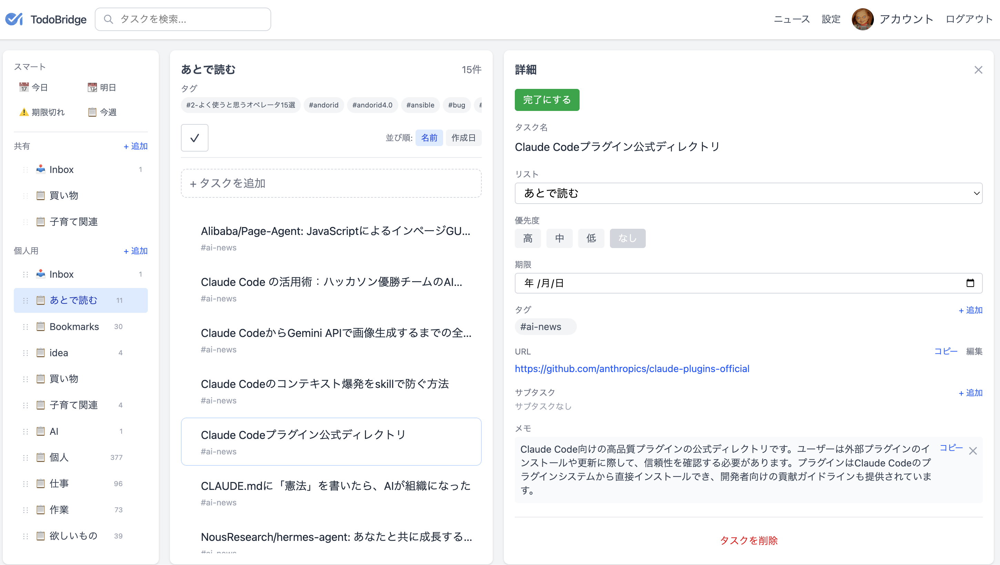
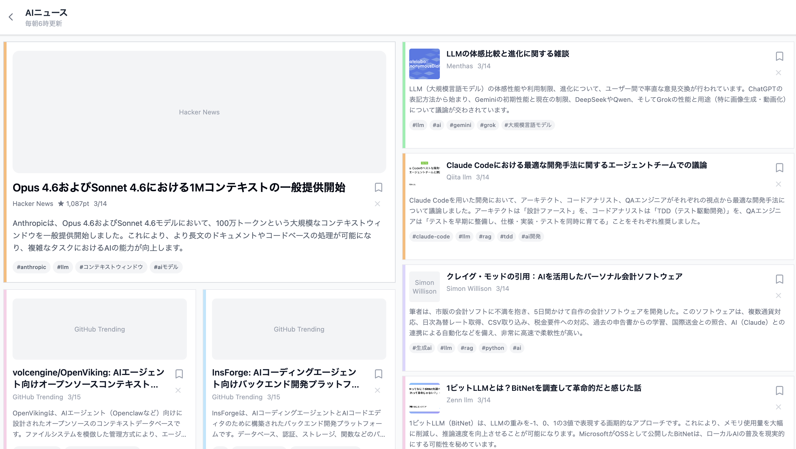
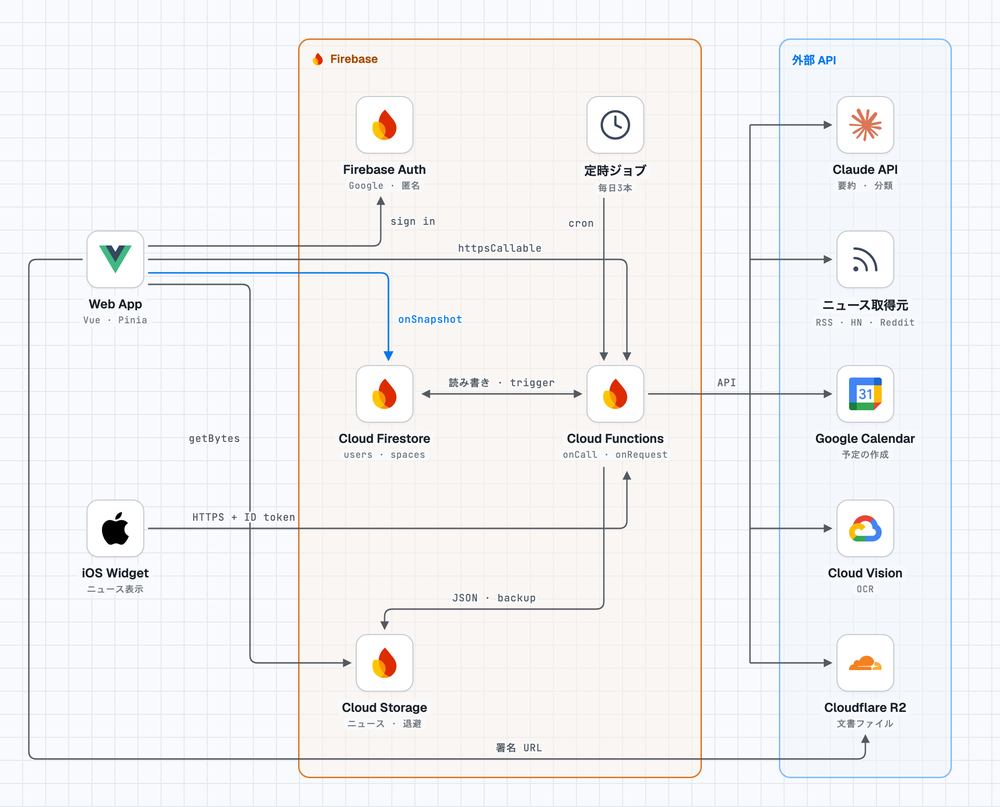

# TodoBridge


TodoBridge は、RTM代替を目指した、共有対応のタスク管理アプリです。
加えて、AI / iOS / Android などの海外記事も含む情報を集め、日本語で把握しやすく整理して Todo に繋げられます。

## Screenshots

### ホームでタスクと情報をまとめて確認



### 海外の技術記事を日本語で把握しやすく整理



### iOS / Android の更新を確認優先の項目つきで追いやすく表示


iOS / Android アプリ開発で見逃したくない更新を、確認優先の項目と通常の記事一覧に分けて把握しやすくしています。
要対応の記事は公開から180日間、対応済みまたは興味なしにするまで持ち越します。処理済みの一覧から戻すこともでき、あとで読むへの追加や記事のクリックでは消えません。
情報源は Apple と Google の公式ページ7本です（Apple Developer News の日本語版と英語版、App Store Connect のリリースノート、Apple のセキュリティアップデート一覧、Android Developers Blog、Play Console のお知らせ、Android Security Bulletin）。Claude がセキュリティ、SDK 要件、ポリシーの記事だけを選び、概要、対象、期限、やることの4項目に日本語でまとめます。

## このアプリを作った目的

- 複数人で Todo を共有できる構造を持たせたかった
- これまで RSS を1つずつ巡回して集めていた AI / iOS / Android ニュースを、AI を使って効率よく収集したかった
- 集めた情報を、あとで読む・対応する Todo へ自然に繋げられるようにしたかった
- Remember The Milk の置き換えとして使えるアプリが欲しかった
- 将来的には、AI だけでなく育児や金融のような、個人でも家族でも追いたい関心テーマを選べるようにしたかった

## 技術スタック

- フロントエンド: Vue 3, TypeScript, Vite, Pinia
- バックエンド: Firebase Authentication, Firestore, Cloud Functions, Cloud Storage
- テスト: Vitest, Playwright
- 開発環境: Claude Code, Codex, Worktrunk（git worktree の作成と片付け）, Herdr（エージェントを並べて動かす作業環境）, superpowers（設計・TDD・デバッグの進め方を定めるスキル集）, mobile-mcp（iOS 実機での画面確認）

### 構成図

<picture>
  <source media="(prefers-color-scheme: dark)" srcset="./img/todobridge-architecture-dark.png">
  
</picture>

画面は Firestore を直接購読します。権限の要る処理と外部 API の呼び出しは Cloud Functions が受け持ち、文書ファイルだけは Web から署名 URL で Cloudflare R2 に直接読み書きします。

図は [stack-diagram](https://github.com/caru-ini/stack-diagram) で作成しています。

## 主な機能

- タスク一覧と詳細表示
- 複数人での共有を見据えたデータ構造
- 海外記事も含めて収集し、日本語で把握しやすくする翻訳・要約
- AI / iOS / Android などの関心テーマに応じた情報表示
- 情報をあとで読む・対応する Todo へ自然に繋げる構造
- Remember The Milk 形式のインポート
- Google ログイン
- ライト・ダーク・端末設定に合わせる表示テーマの切り替え（端末ごとに保存）

## セットアップ

### 必要環境

- Node.js（バージョンは `functions/package.json` の `engines` に合わせる）
- npm
- Firebase CLI
- Java（Firebase Emulator が要求するバージョン。Emulator を使う確認とルールテストで必要）

### 環境変数

フロントエンドでは以下の環境変数を使用します。

```bash
VITE_FIREBASE_API_KEY=
VITE_FIREBASE_AUTH_DOMAIN=
VITE_FIREBASE_PROJECT_ID=
VITE_FIREBASE_STORAGE_BUCKET=
VITE_FIREBASE_MESSAGING_SENDER_ID=
VITE_FIREBASE_APP_ID=
VITE_FIREBASE_MEASUREMENT_ID=
```

Cloud Functions では ANTHROPIC_API_KEY を secret として使用し、AI ニュースの判定と要約、モバイルニュースの分類と要約に使います。

```bash
ANTHROPIC_API_KEY=
```

モバイルニュースの判定は次の環境変数で調整できます。省略時の既定値は `functions/src/news/mobileClaudeClassifier.ts` を参照してください。

```bash
CLAUDE_NEWS_MODEL=
CLAUDE_NEWS_EFFORT=
CLAUDE_NEWS_DAILY_MAX_REQUESTS=
```

AI ニュースは技術記事だけを1日最大20件表示します。対象は AI コーディングツールの使い方と検証、LLM アプリの実装・評価・運用、AI のセキュリティ、新しいモデルや API の能力と制約、機械学習の実装、AI 開発用のツールです。企業動向、政治や訴訟、宣伝、業務アプリの操作方法、AI が道具として登場するだけの記事は表示しません。

選別は2段階です。軽量な Claude モデルがタイトルと説明文から主題の分類と採用・保留・除外を判定し、明らかな対象外だけを外します。採用と保留の候補は本文（GitHub は README）を取得し、上位の候補だけを上位の Claude モデルが本文で技術内容を確認したうえで日本語の概要を作ります。確認できなかった記事と概要のない記事は表示せず、次の候補で補います。20件に満たない日は埋めません。AI ニュースは全員に同じ一覧を表示し、順位は管理ユーザーの設定と操作から決めます。開発者への有用性を主に、世間での重要度、人気、キーワード設定、Claude が操作履歴から判定する「あなた向け度」（personalFit）を加えます。判定できない日は従来のキーワード学習で並べます。仕組みは後述の「AI 固定フィード」を参照してください。集約サイト経由の記事は実際の掲載元を主に表示し、紹介元を併記します。主題の判定と本文確認の結果は判定基準の版ごとに7日間再利用し、それを過ぎた記事やタイトルが変わった記事は判定し直します。次の環境変数で調整できます。省略時の既定値は `functions/src/news/aiClaudeTriage.ts`、`functions/src/news/aiClaudeSummary.ts`、`functions/src/news/v2/curatorPersonalFit.ts` を参照してください。

```bash
CLAUDE_AI_TRIAGE_MODEL=
CLAUDE_AI_TRIAGE_EFFORT=
CLAUDE_AI_TRIAGE_DAILY_MAX_REQUESTS=
CLAUDE_AI_SUMMARY_MODEL=
CLAUDE_AI_SUMMARY_EFFORT=
CLAUDE_AI_SUMMARY_DAILY_MAX_REQUESTS=
CLAUDE_AI_FIT_MODEL=
CLAUDE_AI_FIT_EFFORT=
CLAUDE_AI_FIT_DAILY_MAX_REQUESTS=
```

AI ニュースの呼び出し上限は日本時間の日付ごとに主題の判定、要約、あなた向け度（`ai-fit`）を別々に数えます。あなた向け度の既定値はモデル `claude-haiku-5-5`、effort `low`、日次上限9リクエストです。候補は基礎スコア上位90件、1バッチ30件で、判定の締め切りは要約と別に60秒です。API の再試行は同じ呼び出しとして数えます。

AI 固定フィードの生成には `NEWS_CURATOR_UID` で選別に使う管理ユーザーを指定します。`NEWS_FEED_BUCKET` はフィードの保存先 Storage バケット名で、省略時は既定のバケットを使います。 `NEWS_ACTION_ALLOWED_ORIGINS` は管理操作 API の CORS で許可するオリジンをカンマ区切りで指定します。管理操作 API は `dismiss`、`readLater`、`open` を受け付けます。Web は管理ユーザーが記事を開くと `open` を送り、同じ記事の記録はサーバー側で1件にまとめます。閲覧ユーザーは送りません。送信に失敗しても記事の表示や管理操作の状態は変わりません。管理ユーザーを指定し、その設定と操作イベントを読めた日は、Claude で要約するのは固定フィードに選ばれた記事だけです。このとき利用者ごとのフィード（iOS ウィジェットが読む形式）は要約済みの記事だけから選ぶため、20件に満たない日があります。管理ユーザーの設定を読めなかった日は、従来どおり利用者ごとのフィードの上位記事も要約します。

AI 固定フィードは管理ユーザーの直近90日の操作イベントから、Claude が候補ごとのあなた向け度を判定します。同じ記事では「あとで読む」、興味なし、開いた記録の順に優先し、好き側（あとで読む・開いた）と興味なし側を新しい順に各30件まで使います。Claude へ渡す履歴は操作の種類・題名・タグだけで、概要は送りません。判定は high 1.3倍、normal 1.0倍、low 0.7倍で順位へ反映し、未判定の記事は1.0倍です。明示したキーワード設定も引き続き使います。判定は公開フィードに含めず、共有記事にも保存しません。履歴なし、API障害、日次上限、全件欠落、例外の場合も配信を続け、従来のキーワード学習（あとで読む +2、興味なし -1、30日で重みを半減）に戻します。判定が得られた日は学習キーワードの倍率を重ねません。iOS の「あとで読む」も使いますが、iOS からの open 送信には未対応です。旧履歴のクリックと表示回数は使いません。旧履歴の移行には、`functions` で `npm run build` 後に `node scripts/migrate-news-action-events.js --uid <uid> --project <project-id>` を実行します。既定は件数確認だけの dry-run で、`--apply` を付けた場合だけ新規イベントを保存します。既存イベントと旧履歴は上書き・削除しません。Emulator を使う場合は `FIRESTORE_EMULATOR_HOST` を設定します。本番では `newsActionEvents` の複合 index を事前にデプロイして構築完了を待ち、dry-run の確認、`--apply` による移行を済ませてから、イベント学習への切替をデプロイしてください。切替のデプロイ直後に移行スクリプトをもう一度 `--apply` 付きで実行し、最初の移行から切替までに旧経路で記録された操作を回収してください。興味なしは取り消せて、取り消すと操作イベントを削除するため、次の判定から外れます。

家族書類ボックスの保存先は Cloudflare R2 です。Cloud Functions では次の4つを secret として使います。Emulator では R2 を使わず、ローカル保存になります。

```bash
R2_ACCOUNT_ID=
R2_BUCKET=
R2_ACCESS_KEY_ID=
R2_SECRET_ACCESS_KEY=
```

### 開発コマンド

フロントエンド:

```bash
cd web
npm install
npm run dev
```

Cloud Functions:

```bash
cd functions
npm install
npm run build
```

家族書類ボックスをローカルで確認する場合は、Java を PATH に通したうえで、リポジトリ直下で Auth、Firestore、Functions の Emulator と Web をまとめて起動します。

```bash
npm --prefix web run dev:documents
```

`http://localhost:5173` を開き、「ローカル確認用にログイン」からログインした後、ホームの「書類」を選択します。ローカル保存データは Emulator の確認用であり、プロセスを終了するとリセットされます。

同じWi-Fiに接続したスマホから確認する場合は、次のコマンドを使います。MacのLANアドレスを自動検出し、表示された `スマホ確認URL` をスマホで開きます。

```bash
npm --prefix web run dev:documents:mobile
```

LAN内へ開発用ポートを公開するため、信頼できる家庭内ネットワークでのみ使用してください。接続できない場合は、macOSファイアウォールでNode.jsとJavaの受信接続を許可します。

## 検証コマンド

リポジトリ直下で、web と functions の lint、型チェック、テスト、ビルドをまとめて実行します。

```bash
npm run verify
```

個別に実行する場合:

```bash
cd web
npm run lint
npm run type-check
npm run test:run
npm run build
```

```bash
cd functions
npm run lint
npm test
```

Firestore ルールのテストは Emulator を使うため、Java が必要です。

```bash
cd web
npm run test:rules
```

## AI活用方針

このリポジトリでは AI コーディングエージェントを開発に使っています。要件、設計判断、マージ、デプロイは人間が決めます。

- 設計、計画、レビューは Claude Code、実装は Codex が担当します
- テストと実装は別々のエージェントに書かせます。失敗するテストを先にコミットし、実装側はテストを変えずに通します
- PR を開く前に、実装の文脈を持たないエージェントが差分をレビューします。PR を開いた後は Codex の自動レビューと CI（lint、型チェック、テスト、ビルド、Firestore ルールテスト）を通します
- 画面の動きは `.agents/skills/verify-todobridge/` のスキルと e2e の MCP サーバー（`.mcp.json`）を使い、Emulator 上でエージェントが実際に操作して確かめます
- 独立した作業は Worktrunk で git worktree に分け、同じ作業ツリーを複数のエージェントで同時に編集しません。Codex は Herdr のペインで動かし、実行中か完了かを一覧で確かめます
- 実データ、実環境の ID、秘密情報はコード、テスト、ドキュメントに入れません

エージェント共通のルールは `AGENTS.md` にまとめ、Claude Code 用の `CLAUDE.md` からも読み込んでいます。

## 補足

- 要件定義テンプレートは `doc/REQUIREMENTS_TEMPLATE.md` に置いています。
- 機能追加時に使うテンプレートは `doc/FEATURE_IMPLEMENTATION_TEMPLATE.md` に置いています。
- Firebase や API キーなどの秘密情報はリポジトリに含めない前提です。
