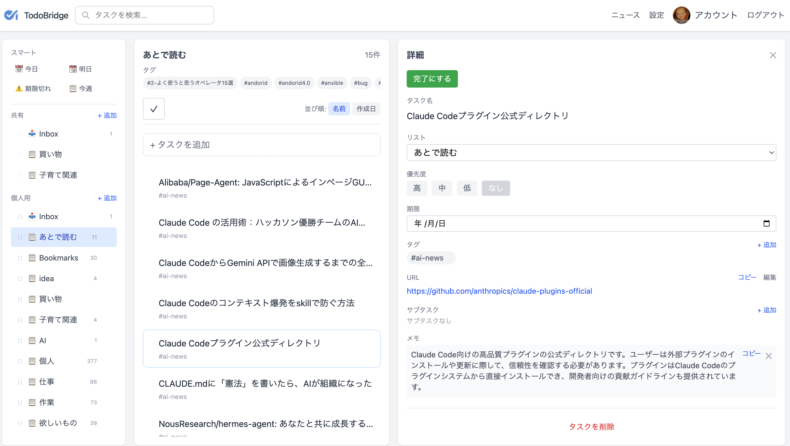
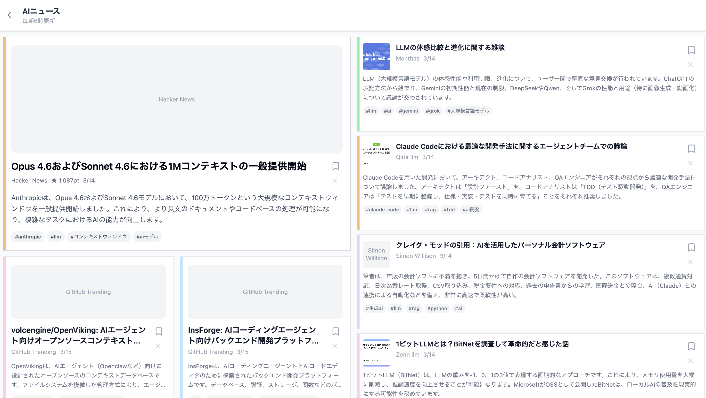
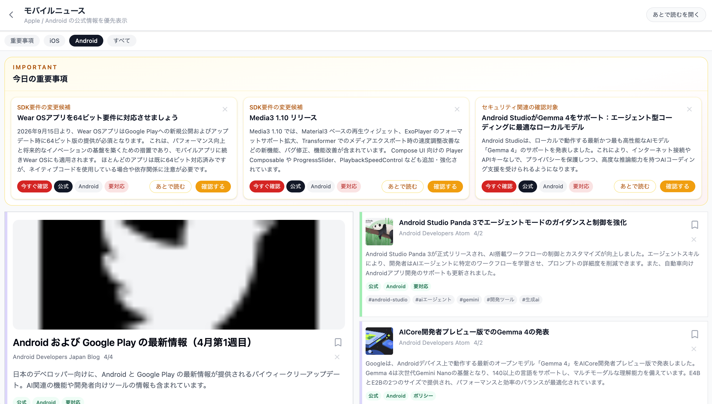

# TodoBridge


TodoBridge は、RTM代替を目指した、共有対応のタスク管理アプリです。
加えて、AI / iOS / Android などの海外記事も含む情報を集め、日本語で把握しやすく整理して Todo に繋げられます。

## Screenshots

### ホームでタスクと情報をまとめて確認



### 海外の技術記事を日本語で把握しやすく整理



### iOS / Android の更新を確認優先の項目つきで追いやすく表示



iOS / Android アプリ開発で見逃したくない更新を、確認優先の項目と通常の記事一覧に分けて把握しやすくしています。
情報源は Apple と Google の公式ページ7本です（Apple Developer News の日本語版と英語版、App Store Connect のリリースノート、Apple のセキュリティアップデート一覧、Android Developers Blog、Play Console のお知らせ、Android Security Bulletin）。Claude（Sonnet 5.5）がセキュリティ、SDK 要件、ポリシーの記事だけを選び、概要、対象、期限、やることの4項目に日本語でまとめます。

## このアプリを作った目的

- 複数人で Todo を共有できる構造を持たせたかった
- これまで RSS を1つずつ巡回して集めていた AI / iOS / Android ニュースを、AI を使って効率よく収集したかった
- 集めた情報を、あとで読む・対応する Todo へ自然に繋げられるようにしたかった
- Remember The Milk の置き換えとして使えるアプリが欲しかった
- 将来的には、AI だけでなく育児や金融のような、個人でも家族でも追いたい関心テーマを選べるようにしたかった

## 技術スタック

- フロントエンド: Vue 3, TypeScript, Vite, Pinia
- バックエンド: Firebase Authentication, Firestore, Cloud Functions, Cloud Storage
- テスト: Vitest, Playwright

## 主な機能

- タスク一覧と詳細表示
- 複数人での共有を見据えたデータ構造
- 海外記事も含めて収集し、日本語で把握しやすくする翻訳・要約
- AI / iOS / Android などの関心テーマに応じた情報表示
- 情報をあとで読む・対応する Todo へ自然に繋げる構造
- Remember The Milk 形式のインポート
- Google ログイン

## セットアップ

### 必要環境

- Node.js
- pnpm
- Firebase CLI

### 環境変数

フロントエンドでは以下の環境変数を使用します。

```bash
VITE_FIREBASE_API_KEY=
VITE_FIREBASE_AUTH_DOMAIN=
VITE_FIREBASE_PROJECT_ID=
VITE_FIREBASE_STORAGE_BUCKET=
VITE_FIREBASE_MESSAGING_SENDER_ID=
VITE_FIREBASE_APP_ID=
VITE_FIREBASE_MEASUREMENT_ID=
```

Cloud Functions では ANTHROPIC_API_KEY を secret として使用し、AI ニュースの判定と要約、モバイルニュースの分類と要約に使います。

```bash
ANTHROPIC_API_KEY=
```

モバイルニュースの判定は次の環境変数で調整できます（省略時は既定値）。

```bash
CLAUDE_NEWS_MODEL=claude-sonnet-5-5
CLAUDE_NEWS_EFFORT=low
CLAUDE_NEWS_DAILY_MAX_REQUESTS=5
```

AI ニュースは技術記事だけを1日最大20件表示します。対象は AI コーディングツールの使い方と検証、LLM アプリの実装・評価・運用、AI のセキュリティ、新しいモデルや API の能力と制約、機械学習の実装、AI 開発用のツールです。企業動向、政治や訴訟、宣伝、業務アプリの操作方法、AI が道具として登場するだけの記事は表示しません。

選別は2段階です。Claude（Haiku 5.5）がタイトルと説明文から主題の分類と採用・保留・除外を判定し、明らかな対象外だけを外します。採用と保留の候補は本文（GitHub は README）を取得し、上位の候補だけを Claude（Sonnet 5.5）が本文で技術内容を確認したうえで日本語の概要を作ります。確認できなかった記事と概要のない記事は表示せず、次の候補で補います。20件に満たない日は埋めません。順位は開発者への有用性を主に、世間での重要度、人気、既存の設定やクリック履歴を加えて決めます。集約サイト経由の記事は実際の掲載元を主に表示し、紹介元を併記します。判定と確認の結果は判定基準の版ごとに7日間再利用し、それを過ぎた記事やタイトルが変わった記事は判定し直します。次の環境変数で調整できます（省略時は既定値）。

```bash
CLAUDE_AI_TRIAGE_MODEL=claude-haiku-5-5
CLAUDE_AI_TRIAGE_EFFORT=low
CLAUDE_AI_TRIAGE_DAILY_MAX_REQUESTS=10
CLAUDE_AI_SUMMARY_MODEL=claude-sonnet-5-5
CLAUDE_AI_SUMMARY_EFFORT=low
CLAUDE_AI_SUMMARY_DAILY_MAX_REQUESTS=6
```

AI ニュースの呼び出し上限は日本時間の日付ごとに判定と要約を別々に数えます。API の再試行は同じ呼び出しとして数えます。

### 開発コマンド

フロントエンド:

```bash
cd web
pnpm install
pnpm dev
```

Cloud Functions:

```bash
cd functions
npm install
npm run build
```

家族書類ボックスをローカルで確認する場合は、リポジトリ直下で Auth、Firestore、Functions の Emulator と Web をまとめて起動します。

```bash
PATH="/opt/homebrew/opt/openjdk@21/bin:$PATH" pnpm --dir web dev:documents
```

`http://localhost:5173` を開き、「ローカル確認用にログイン」からログインした後、ホームの「書類」を選択します。ローカル保存データは Emulator の確認用であり、プロセスを終了するとリセットされます。

同じWi-Fiに接続したスマホから確認する場合は、次のコマンドを使います。MacのLANアドレスを自動検出し、表示された `スマホ確認URL` をスマホで開きます。

```bash
PATH="/opt/homebrew/opt/openjdk@21/bin:$PATH" pnpm --dir web dev:documents:mobile
```

LAN内へ開発用ポートを公開するため、信頼できる家庭内ネットワークでのみ使用してください。接続できない場合は、macOSファイアウォールでNode.jsとJavaの受信接続を許可します。

## 検証コマンド

```bash
cd web
pnpm test:run
pnpm type-check
pnpm build
```

Functions:

```bash
cd functions
npm test
```

## AI活用方針

このリポジトリでは AI コーディングエージェントを開発補助に利用しています。ただし、変更方針、根本原因の特定、最終的なレビューと検証は人間が責任を持って行う前提です。

`AGENTS.md` は Codex 向けの設定ファイルであると同時に、このリポジトリで重視している開発原則を機械可読な形でまとめたものです。最小差分、根本原因の修正、対象を絞った検証を重視しています。

## 補足

- 設計メモや実装計画は `doc/` 配下にあります。
- AI を使った開発の進め方は `doc/AI_DEVELOPMENT_WORKFLOW.md` にまとめています。
- プロダクト全体の要件整理は `doc/PRODUCT_REQUIREMENTS.md` にまとめています。
- 要件定義テンプレートは `doc/REQUIREMENTS_TEMPLATE.md` に置いています。
- retrospective な要件定義の例は `doc/RETROSPECTIVE_REQUIREMENTS_EXAMPLE.md` にまとめています。
- テーマ選択型の情報機能の要件と設計メモは `doc/THEMED_FEED_REQUIREMENTS.md` と `doc/THEMED_FEED_DESIGN.md` にまとめています。
- 家族書類ボックスの要件、設計メモ、実装計画、保存プライバシー方針は `doc/FAMILY_DOCUMENT_REQUIREMENTS.md`、`doc/FAMILY_DOCUMENT_DESIGN.md`、`doc/FAMILY_DOCUMENT_IMPLEMENTATION_PLAN.md`、`doc/FAMILY_DOCUMENT_STORAGE_PRIVACY.md` にまとめています。
- OCR方式、外部送信範囲、同意文、費用上限は `doc/FAMILY_DOCUMENT_OCR_DECISION.md` にまとめています。
- 機能追加時に使うテンプレートは `doc/FEATURE_IMPLEMENTATION_TEMPLATE.md` に置いています。
- Firebase や API キーなどの秘密情報はリポジトリに含めない前提です。
